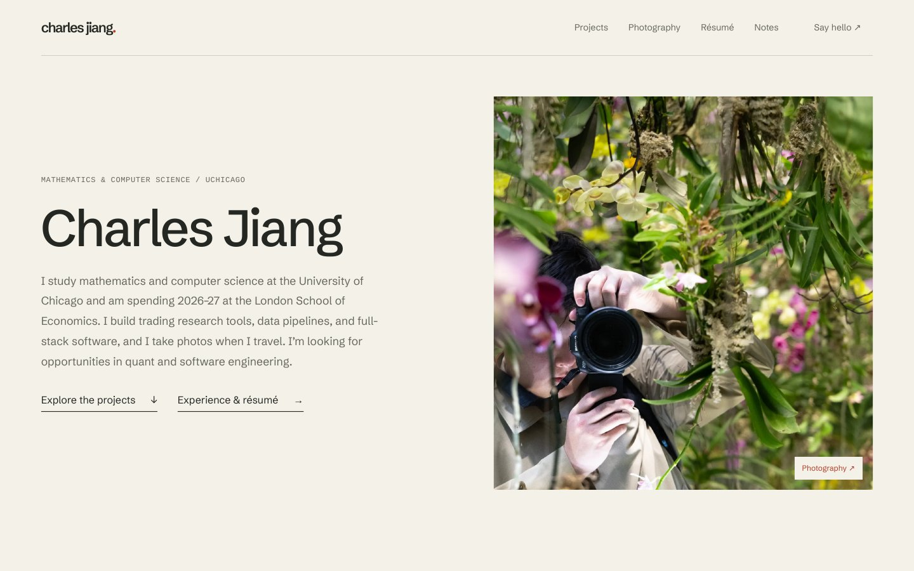

# Charles Jiang — personal site



**Live:** [jiang6082.github.io](https://jiang6082.github.io/)

Project walkthroughs, a web résumé, notes, and photography.

**Stack:** Astro, TypeScript, Three.js (optional 3D views), Sharp, Schibsted Grotesk.

## Run locally

```sh
npm ci
npm run dev        # http://localhost:4321
```

## Build and check

```sh
npm run build
npm run check      # astro check + site checks; run after a build
npm run preview
```

## Where things live

| What                   | Where                                                 |
| ---------------------- | ----------------------------------------------------- |
| Name, links, analytics | `src/config.ts`                                       |
| Projects               | `src/data/projects.ts`                                |
| Project walkthroughs   | `src/data/research.ts`                                |
| Résumé                 | `src/data/resume.ts`                                  |
| Notes                  | `src/content/blog/`                                   |
| Photos                 | `npm run photos:manage` (see `PHOTO-MANAGER.md`)      |
| Share image            | `npm run og` regenerates `public/og.jpg`              |
| Colors and type        | `src/styles/global.css`                               |

## Deploy

Every push and pull request builds the site and runs the checks. Pushes to `main` deploy to GitHub Pages via `.github/workflows/deploy.yml`.
